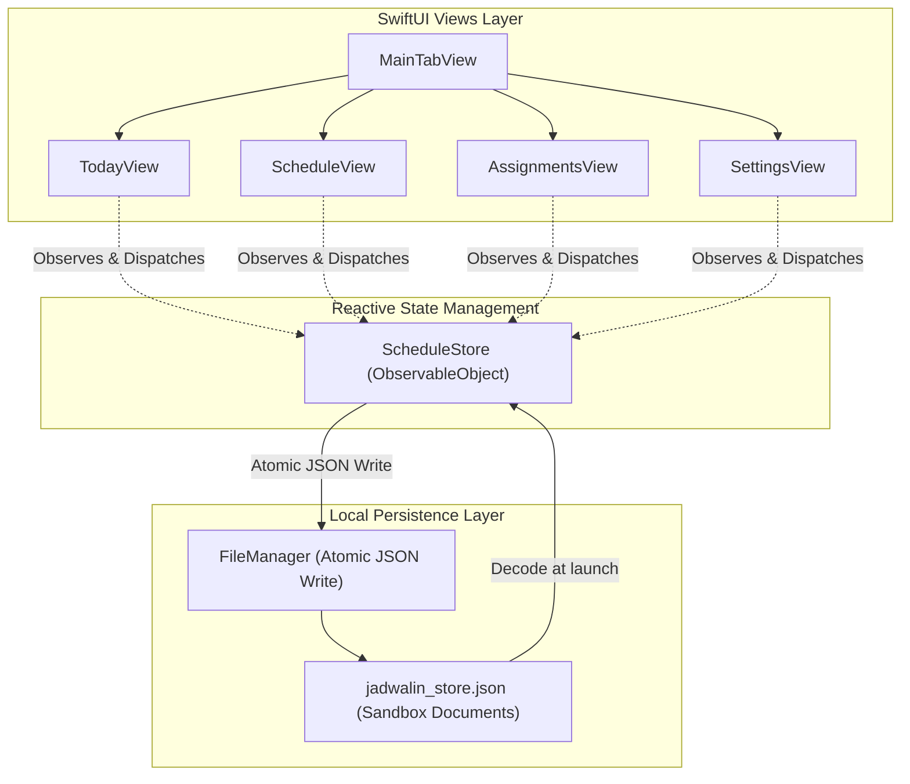
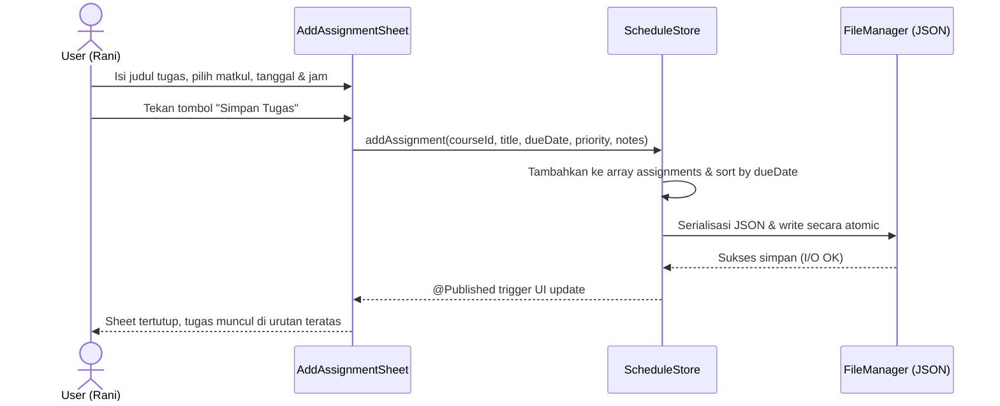

# Technical Design: Jadwal-In Core Engine

## 1. Arsitektur Sistem



---

## 2. Model Data & Relasi (Entity-Relationship)

```mermaid
erDiagram
    COURSE ||--o{ ASSIGNMENT : has
    COURSE {
        UUID id PK
        string name
        string code
        string lecturer
        string room
        int dayOfWeek
        string startTime
        string endTime
        string colorHex
    }
    ASSIGNMENT {
        UUID id PK
        UUID courseId FK
        string title
        datetime dueDate
        string priority
        boolean isCompleted
        string notes
    }
```



### Definisi Swift Data Types

```swift
public enum DayOfWeek: Int, Codable, CaseIterable, Identifiable {
    case monday = 1, tuesday, wednesday, thursday, friday, saturday, sunday
    public var id: Int { rawValue }
    public var localizedName: String { ... } // "Senin", "Selasa", dst.
}

public enum Priority: String, Codable, CaseIterable, Identifiable {
    case low = "Rendah"
    case medium = "Sedang"
    case high = "Tinggi"
    public var id: String { rawValue }
}

public struct Course: Identifiable, Codable, Hashable {
    public let id: UUID
    public var name: String
    public var code: String
    public var lecturer: String
    public var room: String
    public var dayOfWeek: DayOfWeek
    public var startTime: String // format "HH:mm"
    public var endTime: String   // format "HH:mm"
    public var colorHex: String
}

public struct Assignment: Identifiable, Codable, Hashable {
    public let id: UUID
    public var courseId: UUID
    public var title: String
    public var dueDate: Date
    public var priority: Priority
    public var isCompleted: Bool
    public var notes: String
    
    // Computed Urgency
    public var urgency: UrgencyLevel { ... }
    public var formattedRemainingTime: String { ... }
}
```

---

## 3. Alur Interaksi State (Sequence Diagram)



---

## 4. Penanganan Edge Cases & Keamanan Data
1. **Mata Kuliah Dihapus:** Jika suatu `Course` dihapus, seluruh `Assignment` yang terhubung akan ditandai dengan `courseId = nil` atau dihapus bersamaan dengan peringatan dialog konfirmasi untuk mencegah data korup.
2. **Crash Resilience:** Menggunakan `Data.write(to: fileURL, options: .atomic)` yang menulis ke berkas sementara terlebih dahulu sebelum menggantikan berkas utama. Jika terjadi pemadaman daya/crash, data lama tetap selamat.
3. **Seed Data Otomatis:** Saat pertama kali aplikasi dibuka (`jadwalin_store.json` belum ada), `ScheduleStore` akan otomatis menyuntikkan *sample data* realistis jadwal kuliah semester 3 Rani (misal: Algoritma, Basis Data, Jaringan Komputer, dsb.) sehingga pengguna langsung melihat wujud aplikasi yang hidup.
